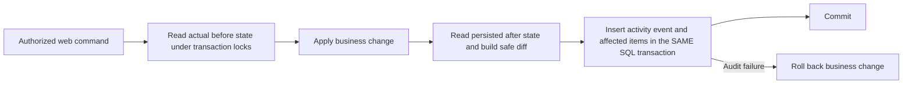

# Dev Tools: Activity Log

Status: implemented and installed in the local web publication on 29 October
2026. The two audit tables are active and seven existing recovery actions were
imported idempotently. Scope confirmed by the user: **web app only**.

## Purpose and decisions

Add **Dev Tools → Activity Log** so Developers can see who performed an admin
action, which employee or item it affected, what changed, and its actual result.

- Record semantic business actions, not guesses based on HTTP status codes.
- Capture database-read **Before → After** values for committed changes.
- Cover Admin Tools, employee/skill/file edits, role management and Skill Recovery.
- Make employee history the default view; keep all saved changes and unsuccessful
  attempts in separate views. Routine page opens do not generate activity events.
- Keep the viewer read-only. Existing guarded Skill Recovery remains the place
  for eligible corrections and Undo.
- Preserve existing Admin/Developer permissions. Admins generate audit events
  but do not gain access to this Developer-only viewer.
- Do not instrument Windows app or direct SQL writes, or claim they are covered.

The current request middleware records paths, users, HTTP status and timing.
`LoggingService` keeps bounded in-memory technical logs. Neither proves a saved
business change: an HTTP 200 can contain a rejected form. Skill Recovery already
has a durable transactional audit that this design will reuse.

## Viewer

Use a full-width laptop layout with the existing collapsed navigation, theme,
global date picker and native details dialog. Short labels:

```text
Activity Log                         Coverage: Web app

[Employee history]  [All changes]  [Attempts]

[Employee code: 101] [Changed by] [Skill / item] [Action] [Result]
[This year → Today] [Search]

Who          Action             Employee    Skill / item    Date & time    Result
101 · Name   Add skill          0012345     Process A       29 Oct 10:30   Saved >
101 · Name   Move process       —           Process A       29 Oct 10:24   Saved >
102 · Name   Remove PDF         0012345     Process B       29 Oct 10:18   Saved >
```

Defaults: **Employee history**, this year through today, newest first, 50 events per page.
Display Bangkok local time with the existing Gregorian-year calendar. Convert
local date boundaries to UTC for queries; use an exclusive upper date boundary.

Employee code is the affected employee, not the acting administrator. Exact code
matching preserves leading zeros. The employee view shows committed, partial or
recorded no-change events with an actual non-Access employee item. Page visits,
reports and sign-in observations are excluded. Bulk or move events display the
item matching both employee and skill filters; details retain the full event.
All changes still includes catalog updates with no employee. Existing historical
access records are retained; no audit data is deleted by this view change.

Details open in a popup containing actor and role at the time, action, affected
records, result, timestamp, reference, optional reason, and a field comparison:

| Field | Before | After |
| --- | --- | --- |
| Job grade | 51T | 52T |
| Workshop | Workshop A | Workshop B |
| Shift | A | B |

For bulk actions, show one summary and expandable employee items. For skills,
show employee, process, version and Current/Obsolete context. File changes show
safe file metadata, not binary data or internal storage paths.

Results use both text and color: **Saved**, **Blocked**, **Rejected**, **Failed**,
**No change**, **Ready**, and **Unknown** where the outcome cannot be confirmed.
An interrupted multi-item operation can be **Partial** or **Incomplete**; never
present its successful items as rolled back when they were committed.

Preserve both historical role flags. Display only **Developer** when that actor
held Developer and Admin together, matching the existing UI convention. Old
events without role/name information show “Not recorded”; do not substitute the
actor's present role or name as historical fact.

No generic Undo, Delete, Clear log or raw JSON button. Eligible recovery records
link to the existing guarded recovery history using its original action ID.

## Coverage and event names

| Area | Actions to record | Changes to include |
| --- | --- | --- |
| Employee | Add employee, Update employee, Transfer, Resign, Promote | Changed profile/assignment/status fields and affected skill rows |
| Skills | Add skill, Update skill, Disqualify | Exact affected versions, dates/results/classification/status/Remark |
| Files | Change photo, Add PDF, Replace PDF, Remove PDF | Owner/version identity and old/new file metadata |
| Admin Tools | Add workshop, Add process, Move process, Bulk update | Created catalog items, source/destination workshop, employee patches |
| Access roles | Give/remove Admin, Give/remove Developer | Target employee, role kind and membership before/after |
| Skill Recovery | All existing recovery actions and Undo | Reference the existing audit and its trusted snapshots |
| Activity | Authorized menu/profile page served, report/file prepared, preview with no save | Canonical action and safe target metadata; no invented diffs |
| Attempts | Authorization denied, validation rejected, conflict, known rollback, unavailable operation | Safe reason code and request correlation; no committed-change claim |

Record meaningful server-side menu actions. Do not log every click, keystroke,
scroll, static asset or arbitrary search/query string. Missing Files Center scans
are read activity, not employee edits. “Report ready” describes server preparation;
it does not prove the browser received or opened the download.

Date-driven expiry is not an admin edit. Preserve a skill's state at the event
time instead of recomputing its historical badge using today's date.

## Trusted context and safe fields

Introduce a server-created `WebActivityContext`: actor employee code from the
validated session `UserCode`, fresh role flags, optional name snapshot, server
request ID and a command/operation ID. Never accept an actor, role, original
snapshot or success flag from posted form fields.

`Verifier`, `ResignBy`, `TransferBy`, `PromotedBy` and `GetRecordingUser()` are
business/display values, not substitutes for the authenticated actor code.
Authentication events must be emitted after credential validation; middleware
captures the login request's identity before its handler and can report anonymous.

Use typed field allowlists:

- Employee: code, English/Thai name fields, join date, grade, department, section,
  workshop, shift and employment/promotion/transfer state.
- Skill: table + `OcrSkillRowId`, process, classification, training/certificate
  dates, scores/levels/results, verifier, disqualification and Remark fields.
- File: kind, owner, FileId, safe filename, size and available SHA-256 metadata.
  Legacy file contents cannot be reconstructed if they were overwritten elsewhere.
- Catalog: exact IDs and labels used by existing guards. ProcessID alone is not
  a reliable unique identity today; preserve its name and workshop before/after.
- Roles: target employee, role kind and boolean membership only.

Never serialize an Employee/request model wholesale. Never retain passwords,
password hashes, connection strings, cookies, tokens, raw session IDs, upload
capabilities, PDF/photo bytes, request bodies or arbitrary headers/query strings.
Password events may say only “Password changed”; never capture the value.

HTML-encode all displayed data. Return sanitized detail DTOs, not original
Skill Recovery PlanJson. Optional IP data must use the connection address or
explicitly trusted proxy configuration; an arbitrary forwarded header is not identity.

## SQL storage

SQL Server 2014, compatibility 100 remains supported. Use relational filter
columns and versioned JSON detail payloads parsed in C#; no SQL JSON functions.
Place the tables in the existing `OperatorCertificationRecordDB` so each SQL
business change and its audit can share the same local database transaction.

| Table | Main fields and purpose |
| --- | --- |
| `dbo.tblWebActivityEvent` | Clustered bigint EventId; unique EventUid; OperationId; OccurredUtc and RecordedUtc; Source/Origin; category/action/outcome; actor code/name and nullable historical Admin/Developer flags; safe summary; request ID; origin event reference; schema version |
| `dbo.tblWebActivityChange` | EventId + item ordinal; affected employee code; entity type/key/label; table context; insert/update/delete/link effect; before/after existence; allowlisted before/after/changed-field JSON or original recovery reference |

Use employee codes as strings, preserving leading zeros. Audit actor and subject
codes have no foreign key to tblEmployee, so removing an employee cannot erase
or block history. The event-to-change foreign key has no cascading delete.

`OperationId` groups a logical command and is **not globally unique per event**:
partial operations and attempts can have multiple events. `EventUid` is unique.
Add an idempotent origin reference such as `(OriginKind, OriginEventId, Part)`
with a filtered unique index when an origin ID exists. This deduplicates role
outbox delivery and recovery imports without losing legitimate child results.

Index time + EventId, actor + time, action/outcome + time, OperationId, and change
items by employee/entity + EventId. Query parameters are bounded and parameterized.
Do not scan JSON payloads to filter an employee or action. Bound detail page sizes
and use a signed paging cursor; an initial maximum EventId can freeze pagination
until Refresh while delayed outbox events arrive.

## SQL change invariant



The writer takes the existing SqlConnection/SqlTransaction. It must not open a
separate audit connection for a successful SQL mutation. An audit failure means
the change was not saved; do not catch it and continue to commit.

Read snapshots from SQL, not posted “old” values. Preserve rowversion and existing
fresh authorization checks. Reuse protected command IDs for Bulk/Skill Recovery;
other forms need a server-issued command identity if retries can create duplicate
records/files. Check deduplication before repeating the mutation, not just when
inserting its audit. A no-op must not become a fictitious changed-field event.

Use a committed-command receipt in the event table: reserve `OriginKind=WebCommand`
for successful/No-change results, with a mandatory unique server CommandId and
stable Part key (one part for an atomic command; a stable target key for each
independently committed item). Lock/check that origin key before DML in the same
transaction. On replay, compare actor, action, target and a fingerprint of the
allowlisted non-secret command, then return its prior result without another write;
a mismatched command is a conflict. Failed/rejected/preview events use different
origin kinds and never count as completed receipts. Password fingerprints contain
only a change-request marker, never password-derived material. A different
password change requires a fresh command identity. File fingerprints may include
allowed file SHA metadata, not upload capability IDs.

Rejected/failed attempts are recorded outside the rolled-back business transaction
where possible. Technical logs remain available when SQL is unavailable. If commit
acknowledgement is lost, record the attempt as Unknown and reconcile by operation
identity; do not assert rollback solely from a connection error.

The existing bulk-disqualify handler commits each process separately and swallows
individual failures. Preserve truthful per-item results under one OperationId
and append a final summary, or deliberately refactor it to one transaction.
The first implementation must not silently describe today's behavior as atomic.

## Role files: durable delivery without false atomicity

Admin and Developer memberships currently live in separate JSON files. SQL and
file replacement are not one atomic transaction. Keep the present authority and
permissions; introduce a backward-compatible versioned file envelope:

```text
schemaVersion + membershipRevision + members[] + pendingAuditEvents[]
```

Within the role service's existing lock, authorize the operation, compute the
membership change and trusted event, and publish BOTH in one atomic file rewrite.
Existing array-only role files remain readable and upgrade on an audited write.
Preserve Developer → Admin lock ordering and last-role-holder safeguards.
All web role readers must support both formats before the first envelope write;
an older binary must not share the upgraded files during a mixed-version rollout.

An internal dispatcher inserts the pending event/items into SQL idempotently,
then acknowledges that event in the latest file envelope under the same lock.
SQL-before-ack crashes cause a harmless duplicate delivery; SQL failure leaves
the durable event pending. Acknowledgement must preserve newer memberships and
unacknowledged events. Dispatch uses the trusted stored actor-at-change snapshot;
it must not discard an event because that actor later lost the role.

Bound pending count and bytes; implemented limits are 1,000 pending events
or a 5 MiB role envelope per file, whichever is reached first. Never evict unsent
events. If capacity is exhausted or the combined atomic file/outbox write fails,
leave membership unchanged and return a clear failure. Retry delivery with
backoff and expose queue health rather than silently dropping pending history.

The viewer distinguishes the role change's actual saved outcome from its pending
delivery. Show queue health/last error; never report missing audit rows as proof
that no role change occurred. Multiple web writers require shared cross-process
write exclusion; a later multi-instance design can migrate role authority to SQL.

## Existing Skill Recovery history

Do not replace or rewrite `tblSkillRecoveryAction`. For future recovery commands,
insert an indexed Activity reference in the existing recovery SQL transaction.
Reuse its ActionId and original before/after snapshots for details and Undo links;
do not count the same recovery twice or expose its private plan fields.

An idempotent backfill can register existing recovery actions using their real
CreatedUtc, Actor and captured snapshots. Missing historical names, roles and IPs
remain unknown. Ordinary past employee edits cannot be reconstructed accurately
from current rows, overwritten last-action fields or HTTP logs.

## Implementation map

| Existing area | Required integration |
| --- | --- |
| `Services/Logging/*` | Keep request diagnostics; add safe operation correlation, not before/after inference |
| `AdminCatalogSqlStore` | Write catalog event/items before its existing transaction commits |
| `BulkEmployeeSqlStore` | One batch event with actual changed employee items inside its transaction |
| `EmployeeService` in `DataServices.cs` | Add trusted context and audit-safe projections; wrap standalone employee/transfer/disqualification writes in transactions |
| `EmployeePhotoStorageService`, `EmployeeCertificateStorageService` | Join the existing SQL publication transaction; avoid duplicate wrapper events; separately account for legacy filesystem boundaries |
| `Pages/UpdateUser`, `AddUser`, `AddSkill`, `UpdateSkill`, `ViewUser` | Supply authenticated context and explicit semantic outcomes; represent partial results honestly |
| `AdminService`, `DeveloperRoleService`, `AccessRole`, `Admins` | Durable role envelope/outbox, identity snapshots and idempotent delivery |
| `SkillRecoverySqlAudit` | Atomic Activity reference and typed, redacted history adapter |
| New `Pages/DevTools/ActivityLog` | Fresh Developer guard on list/details endpoints; no-store; server filtering/paging; read-only native details popup |

New focused services can be `WebActivityContextFactory`, `WebActivityWriter`,
`WebActivityReader`, `WebActivityDiff`, `RoleActivityDispatcher` and
`RecoveryActivityImporter`. Audit DTOs are immutable and independent of form models.

Audited file publication requires SQL mode and fails closed before legacy
filesystem writes. Existing legacy reads remain available. The current local
launcher enables SQL reads and writes globally; file links and audit events
commit in the same SQL transaction.

## Rollout and acceptance

1. Add schema, typed writer/reader, Developer viewer and coverage indicator.
2. Instrument catalog/bulk and ordinary employee/skill/file operations at their
   actual write boundaries; add the recovery adapter and reference backfill.
3. Add role envelopes/delivery with crash recovery tests, preserving memberships.
4. Add canonical menu/profile/report activity and blocked/failed attempt events.

The feature is complete only when all in-scope mutation paths are covered. During
rollout, show the enabled coverage instead of claiming complete web history.

Required verification:

- Admin/ordinary user cannot list or fetch details; Developer access is checked
  again after role removal. Dual-role actors render as Developer.
- Real SQL tests prove exact before/after values, source/target identity,
  rollback on audit failure, no duplicate mutation on replay, and preservation
  of unrelated records and existing Skill Recovery Undo behavior.
- Bulk and resign/promotion actions list every actual affected row; partial
  disqualification never reports all-success or all-rollback incorrectly.
- Password/token/body/file-content redaction tests inspect stored payloads.
- Role crashes before publication, after file publication, and after SQL insert
  recover without lost membership changes, duplicate events or lost outbox items.
- UI checks cover filters, leading-zero codes, local date boundaries, detail
  comparisons, long values, pagination and laptop/mobile layouts.

Keep change history without automatic deletion in the first version until a
retention policy is selected. Menu/read/attempt events should have a shorter,
configurable retention policy. Do not add destructive purge controls to this UI.
Append-only application APIs and restricted SQL permissions protect ordinary
operation; they are not a claim of tamper-proof storage against database admins.

Coverage starts when each web path is instrumented. Windows app edits, manual
SQL, direct role-file edits and changes to external legacy files remain outside
this web-only attribution guarantee.

## Installed behavior and verification

The table separates Who, Action, Employee ID, Skill / item, Date & time and
Result. Developer-only list and details access rechecks current role authority.
Before/after details are read-only; recovery links use the original action's
source employee even when its first affected item belongs to the destination.

Signed form commands are bound to actor, session, path and handler for two hours.
SQL receipts compare closed allowlisted form/query fingerprints and trusted file
hashes. Matching retries do not repeat writes; altered retries fail. Binding
aliases and indexed collections are covered without hashing passwords or private
capabilities. Role envelopes retain consumed receipts for at least the command
lifetime, with a bounded 10,000-receipt capacity and fail-closed publication.

The full web regression suite passed 717 tests with 13 unrelated fixture skips.
The focused feature run passed 155 tests, including real SQL integration cases;
27 final command/recovery-link checks also passed. Six JavaScript tests and
isolated SQL-backed browser checks passed for table values, filters, details,
retries, permissions, catalog/role history and 1280/390px layouts. Browser fixtures
used synthetic databases and role files. No employee, qualification, attachment
or role was edited in the live database to verify this feature.

Schema setup created only audit tables/indexes on SQL Server 2014, compatibility
100. Seven historical recovery references produced nine affected-item records;
repeating the import added zero. Other ordinary edits begin logging with this
installation. Menu/read/attempt recording is best effort with technical warnings
on failure; successful SQL mutations require their transactional audit to commit.
