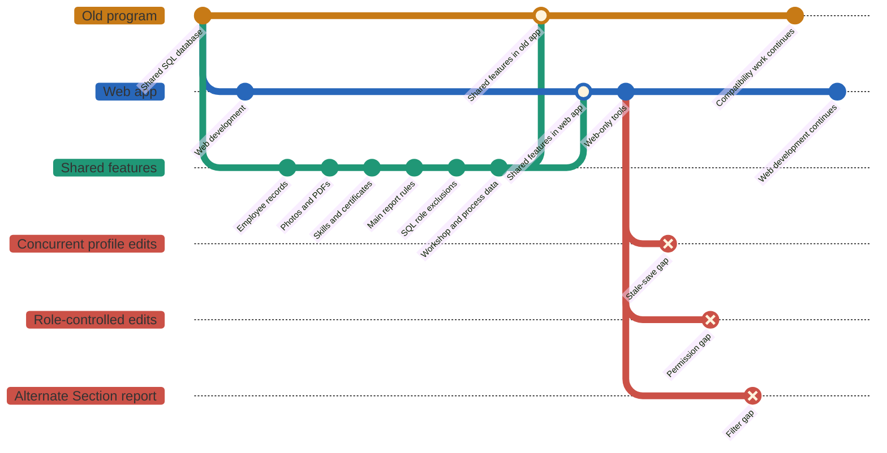
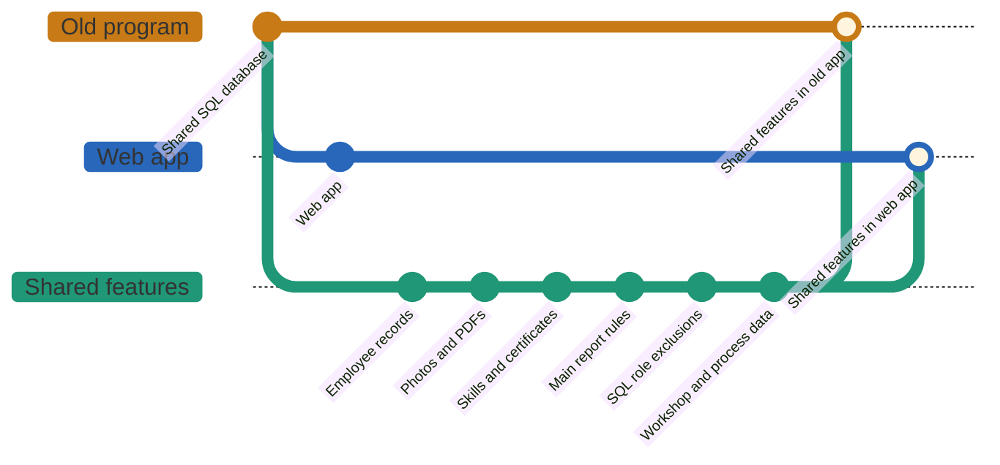
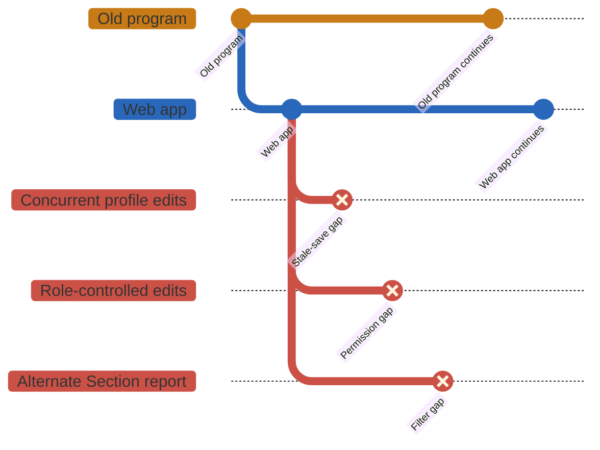

# Legacy Windows and web compatibility implementation plan

> For agentic workers: implement approved tasks with `superpowers:subagent-driven-development`
> or `superpowers:executing-plans`, using the checkboxes below to record progress.

Updated: **2 November 2026, Asia/Bangkok**.

**Goal:** keep both applications compatible while transferring supported workflows to the web.

**Architecture:** share one SQL business database, immutable attachment ownership and SQL role
membership. Change shared contracts with both client adapters; develop web interface features
independently. Transfer write ownership per feature after compatibility checks.

**Tech stack:** Windows Forms / .NET Framework 4.8 x86, ASP.NET Core / .NET 8,
shared .NET Standard 2.0 storage library, SQL Server 2014 / compatibility level 100.

**References:** [current-employee storage scope](CURRENT-EMPLOYEE-SQL-STORAGE-PLAN-2026-10-27.md)
and [shared SQL role contract](SQL-ACCESS-ROLES.md). This plan also covers the requested
coexistence and eventual Windows-to-web handover.

## Delivery snapshot

- [x] Resolved current-employee attachment import recorded as completed on 27 October.
- [x] Shared SQL access roles imported on 2 November: 2 Developers and 10 Admins.
- [x] SQL-aware Windows and web releases built and copied to the local release folders.
- [x] Implementation pushed to branch [`SQL-storage`](https://github.com/akwaa2545-gif/OCR/tree/SQL-storage),
  baseline commit `6005e9e`.
- [ ] Replace and verify the mapped-drive Windows executable and matching dependencies/config.
- [ ] Deploy and verify the updated hosted web build against its intended SQL database.
- [ ] Finish profile stale-save protection and enforce the supported write boundary.
- [ ] Accept each replacement workflow before retiring its Windows version.

The branch snapshot includes the two earlier SQL/web feature commits. The checkboxes record
evidence available when this document was updated; they are not live deployment monitoring.

## Goal and scope

Keep the Windows application usable while the web application develops, then transfer
each feature to the web application without splitting the employee, skill or file data.
Modify the old application where a shared data contract changes; web interface features
can develop independently. This document is a plan, not an application deployment.

Use one application database and one authority for each shared record. Do not introduce
two writable databases, bidirectional synchronization or separate copies of role membership.
Docker is an optional web hosting choice; it is not required for SQL storage.

## Evidence and status

Distinguish **source implemented**, **locally verified**, **database applied** and
**installed client verified**. A successful build or Git merge proves neither deployment
nor compatibility of an executable already running on another PC.

| Area | Current evidence | Remaining rollout check |
| --- | --- | --- |
| Business data | Windows and web connection aliases were verified against the same SQL database. | Verify each deployed client's actual instance and database. |
| SQL attachments | The dated migration record reports 1,519 photos and 13,097 PDFs imported on 27 October. Shared compatibility code exists. | Verify the installed executable, dependencies and SQL read/write settings. |
| Deferred attachments | Ambiguous, missing, invalid and out-of-scope references were not relinked. | Resolve each owner explicitly; do not assume every physical file is in SQL. |
| Reports | Windows source and a local build were aligned with the main web download rules; full export comparisons are documented. | Verify the installed build and the remaining alternate Section route separately. |
| Access roles | SQL import completed on 2 November at 08:26:51 Bangkok in `SVR120A.OperatorCertificationRecordDB`: 2 Developers and 10 Admins. Web SQL storage and Windows SQL report reader are implemented and tested. | Deploy the compatible clients; old web builds must not keep writing JSON as a separate authority. |
| Web tools | Admin Tools, Skill Recovery and web Activity Log have existing implementations. | Verify current release behavior and preserve their documented scope. |

The [production migration record](PRODUCTION-SQL-MIGRATION-2026-10-27.md) is historical
evidence, not a fresh verification of every installed client. Existing source files and
unresolved legacy attachments remain available; this plan does not authorize their deletion.

The role import preserved both schema-1/revision-1 envelopes, zero pending events, and
the existing two Developer / one Admin consumed-command receipts. Source JSON is an
import source, not a parallel authority after the updated web build starts in SQL mode.
No Docker or mapped-drive deployment is established by that database import.

## Shared feature contracts

| ID / feature | Windows compatibility work | Web dependency and acceptance |
| --- | --- | --- |
| F01 Employee | Preserve textual employee codes, existing short IDs and leading zeros; update only allowed profile fields. | New-employee validation must not invalidate existing IDs. Both apps display the same saved employee. |
| F02 Photos / PDFs | Read exact SQL file IDs for SQL-owned attachments; publish immutable versions through the shared storage service. | Same employee, file kind and skill owner must resolve the same bytes in both apps. |
| F03 Skill lifecycle | Preserve stable skill row IDs, explicit archive columns, status and certificate ownership when changing skills. | Current, Disqualified and Obsolete states must mean the same thing after either app writes. |
| F04 Access roles | Reports read Developer exclusions from shared SQL, using the existing application connection. | Web role edits atomically save membership, audit events and command receipts; Admin cannot manage a Developer target. |
| F05 Downloads | Use the agreed eligibility, date boundaries and export columns. | Preview, CSV, XLSX and Windows exports agree for equivalent inputs and the same data snapshot. |
| F06 Catalog | Refresh Workshop / Process lookup data and preserve historical skill identities. | Moving a process assigns it to the selected workshop; it does not keep both links. Section is not a new linking feature. |
| F07 Concurrent edits | Recheck expected row/state/version before saving; reject stale edits and reload. | A web save and a Windows save must not silently overwrite each other or detach a file. |
| W01 Web interface | No matching Windows redesign required. | Laptop layout, dialogs, date picker and remembered browser sign-in remain web features. |
| W02 Admin Tools | Consume compatible shared business data only. | Bulk updates and Missing Files Center can keep a web-only interface. |
| W03 Developer recovery | Correctly read resulting states and file ownership. | Recovery remains web-only and checks the exact row, state and version before applying. |
| W04 Activity Log | No desktop audit is added by this plan. | Coverage remains web actions only; Windows and direct SQL edits are not represented as fully audited. |

### Global constraints

- Employee codes are strings. Keep `0402567` unchanged and do not repad an existing
  short code such as `101`. The web's seven-digit new-employee rule applies to creation.
- Reuse the shared `netstandard2.0` file-storage contracts from both .NET Framework
  Windows and .NET 8 web adapters. Preserve `PhotoFileId`, `CertificateFileId`,
  `OcrSkillRowId` and the applicable `FileStorageVersion` concurrency value.
- SQL-owned files remain authoritative. A SQL error must not silently serve an older
  disk file. Approved legacy paths remain valid only for owners not moved to SQL.
- Publish attachment bytes, owner links and business changes in one transaction.
  Replace with a new immutable file version; do not overwrite an existing blob.
- SQL-owned attachment edits require SQL writes. Profile-only changes preserve file
  links. The current write switch is global; the historical pilot employee list is
  not an implemented per-employee rollout mechanism.
- Preserve history when resigning/deactivating an employee. Do not bypass attachment
  foreign keys by cascading deletion of employee files and qualification history.

## Implementation sequence

### Review focus

| Condition | Required behavior | Task below |
| --- | --- | --- |
| Another app changes a profile or photo while an edit screen is open | Reject the stale save; preserve the committed photo link. | T2 |
| SQL roles cannot be read on a PC without the development folder | Deny privileged checks and stop reports visibly; never substitute an empty list. | T1 |
| A login field contains quotes or SQL syntax | Treat it only as a bound parameter; grant no extra access. | T3 |
| A report includes a late-night end-date row, DAY shift or different job grade | Apply the same named report policy and exclusive next-day boundary everywhere. | T4 |
| A process moves workshops or recovery changes a skill state | Keep historical identity and file ownership; refresh both clients' relevant views. | T5 |

### Phase 1 — Establish the installed baseline

1. Inventory the executable path, build/version, matching `.exe.config`, dependencies,
   database identity and relevant settings for every supported Windows launch location.
2. Record the web build and hosting configuration separately from the source branch.
3. Maintain a feature release worksheet: feature ID, contract version, compatible
   Windows build, compatible web build, database step, verification and current owner.
4. Identify direct SQL writers and already-running old sessions before changing a
   write contract. A new login screen or hidden button cannot control those writers.

**Exit:** the team can identify which installed clients may read and write each feature.
An unverified mapped-drive executable is not marked compatible because its source changed.

### Phase 2 — Finish the Windows compatibility bridge

1. Verify F01–F03 in the actual Windows interface, including photo binding, PDF download,
   skill replacement and historical/archive views. Reuse implemented adapters first.
2. Close F07 profile concurrency gaps. The current desktop profile update filters by
   employee code alone; add an expected-version contract before allowing unrestricted
   simultaneous profile editing. Reuse an applicable existing rowversion where possible;
   inspect schema before proposing additional concurrency columns.
3. Complete F04 client rollout using the [SQL access-role procedure](SQL-ACCESS-ROLES.md).
   Verify the completed Admin and Developer import, including pending events and
   receipts; do not reimport stale JSON over SQL. Use `tblApplicationRoleStore` and `tblApplicationRoleMember` together;
   runtime SQL failure must not fall back to JSON or an empty Developer list.
4. Verify report reads on a PC without the development source folder. Download users
   do not need a Developer role; the list identifies employees excluded from exports.
5. Align desktop authorization for any business operation that remains writable there.
   Reading Developer membership for reports alone does not give desktop authorization parity.
6. Replace legacy interpolated login SQL with parameterized commands as a scoped fix.
   Coordinate any future password-format change across both supported login clients.

**Exit:** agreed read/write contracts work in both directions, stale saves are rejected,
and the role authority is reachable without a development-PC file path.

### Phase 3 — Develop web features alongside compatible releases

1. Develop W01 interface changes independently when they do not change shared data.
2. For F01–F07 business changes, make the contract change, Windows adapter and web adapter
   part of one reviewed feature branch. Add cross-app acceptance evidence before merging.
3. Expand schemas additively first. Retain columns/read shapes needed by supported old
   clients; remove them only after those clients are retired and checked.
4. Keep W02–W04 web interfaces web-only. A recovery action must still create a state the
   supported Windows reader understands. Do not advertise a universal Undo of old actions.
5. For F06, preserve existing process identities and qualification history. Because some
   old records store process names, renaming/deleting catalog entries needs an explicit
   compatibility mapping. A catalog move must not silently rewrite historical skills.

**Exit:** each shared feature has one defined contract and two tested consumers.

### Phase 4 — Transfer ownership one feature at a time

Use this state sequence independently for each feature:

```text
Windows owns writes
    → Both compatible apps may write
    → Web owns writes; Windows reads
    → Windows feature retired
```

Skip the simultaneous-write stage when enforcing safe coexistence would cost more than
making that Windows feature read-only. Preserve useful Windows reading/exporting while
users learn the replacement. Do not transfer all features merely because one is ready.

Enforce ownership at the command/service or database write boundary. Restrict or retire
unsupported direct-SQL writers; a client-side version flag alone cannot stop an old binary.
Introduce a capability check only with a defined enforcement mechanism and release policy.

**Exit for each transfer:** replacement behavior is accepted, supported clients pass the
feature's tests, operational support is ready, and incompatible writers cannot bypass the gate.

### Phase 5 — Retire the remaining Windows functions

Confirm that every required workflow has a web replacement and no supported process
still writes through the retired Windows feature. Contract schema cleanup is a separate,
reviewed change after this evidence exists. Do not rerun the completed attachment import
as a substitute for client rollout or bulk-import unrelated legacy history into web audit.

## Old program and web app compatibility

### Combined view

This restores the original **Git-style layout** in one combined feature graph.
The two main lines are **Old program** and **Web app**. Shared features merge into
both lines; known compatibility gaps remain unmerged in the same graph.



- **Green, merged into both apps:** common records, attachments, skill data,
  main report rules, report role exclusions and catalog data.
- **Red, unmerged:** concurrent profile saves, role-controlled edits and the
  alternate Section report still need alignment.
- **Web-only tools stay on the Web app line:** Admin tools, Skill recovery,
  Activity log and browser sign-in do not require matching Windows screens.

The graph represents feature compatibility, not actual repository history or a
deployment timeline. Shared data does not imply identical edit permissions or
safe concurrent edits. Installed releases and the checks below still need verification.

### Compatible features only

This view keeps only the shared features and their merges into both app lines.
It describes shared data and supported rules, not completion of every rollout check.



### Not yet compatible features only

This view keeps only the known gaps. Red branches remain unmerged until the two
apps follow the agreed behavior. Intentionally web-only tools are not counted as gaps.



### Gaps and verification

| Feature | Current gap | Required outcome |
| --- | --- | --- |
| Concurrent profile edits | Ordinary profile saves do not consistently require the version loaded by the editor. Sharing SQL alone does not prevent stale overwrites. | Both apps reject a stale save and preserve the accepted edit and photo ownership. |
| Role-controlled edits | Windows reads SQL Developer membership for report exclusions; that does not give its write operations the web app's authorization rules or Developer exceptions. | Enforce the agreed permissions at the write boundary, or keep the unmatched operation read-only. |
| Alternate Section report | One alternate web count/export route still differs from the main Inventory/Section policy used by the aligned Windows reports. | Preview and export use the same named population for equivalent filters. |

**Not verified yet:** installed releases, workshop/process changes and recovered
skill states still need the cross-app checks in the task list. They are not marked
as confirmed incompatibilities solely because testing or deployment is pending.

**Web only by design:** Admin tools, Skill recovery, Activity log and browser sign-in
do not need Windows counterparts. Windows and direct SQL edits remain outside the
web Activity Log's documented scope.

## Acceptance and recovery gates

| Check | Required result |
| --- | --- |
| Windows save → web read, then reverse | Same employee fields, skill state and exact attachment owner/bytes. |
| Two editors save the same record | The stale operation is rejected; it cannot silently overwrite the accepted save. |
| Add / update / disqualify / archive / transfer | Correct stable identities, explicit history and certificate ownership; recovery rechecks its selected version. |
| PDF replace / remove; unavailable SQL | Replacement is immutable, removal does not resurrect a legacy reference, failure does not serve a stale disk file. |
| SQL role grant / revoke and replay | Both apps observe current membership; Admin cannot manage Developer users; retries do not duplicate changes/events. |
| Equivalent report filters | Compare full rows and columns, not a fixed historical count. Verify preview and every supported export format. |
| Actual Windows / laptop web interface | Photo binding, navigation, dates and Excel interaction work in the installed clients. Source tests alone do not prove this. |

Inventory and main Section exports allow all grades/shifts under their other current rules.
No-skill, Expiry, Disqualification and Obsoleted use non-DAY shifts and grades 51T/52T;
Resignation has its own eligibility, including a process requirement. Exclude Developers
consistently. Query dates as `>= start.Date` and `< end.Date.AddDays(1)` using typed parameters.
Verify the alternate Section preview/export route separately before claiming every route matches.

Rollback means restoring a **compatible** binary/configuration while preserving committed
data. Do not downgrade SQL-owned file links, restore stale JSON roles or roll back business
records to undo a release. If no previous compatible build exists, pause the affected writes
and fix forward while keeping compatible reads available.

Related evidence: [SQL file-storage runbook](SQL-FILE-STORAGE-RUNBOOK.md),
[download comparison](DOWNLOAD-COUNT-COMPARISON-2026-10-30.md),
[web activity scope](DEV-ACTIVITY-LOG-PLAN.md),
[Skill Recovery scope](DEV-SKILL-RECOVERY-PLAN.md).

## Next change sets

These are implementation instructions for future approved work. This Markdown update
does not run them, deploy applications or change the database.

### T1: Finish the SQL-compatible client rollout

**Release files:** Windows `bin/Release-WebReportRules/Operator Training Record.exe`
with its matching `.exe.config` and DLLs; web `bin/Release-SqlStorage`.
**Contract:** `RoleActivityStorage` selects SQL; `DesktopSqlDeveloperRoles.ReadRoles(string connectionString)`
reads the same database. The JSON role files are no longer the updated clients' runtime authority.

- [ ] Record installed executable/build paths and database identity for each supported launch location.
- [ ] Update the selected Windows launch folder and web environment as a coordinated rollout.
- [ ] On a PC without `C:\code test`, download a report and confirm Developer exclusions.
- [ ] Verify a Developer can manage roles, an Admin cannot manage a Developer, and SQL failure has no JSON fallback.
- [ ] Record installed-client evidence before marking this task complete. Do not rerun the completed imports.

### T2: Prevent stale employee profile saves in both apps

**Modify:** `OperatorCertificationRecord/DesktopEmployeeCommand.cs`, `frmUpdateUser.cs`,
web `o/Employee.cs` (the `Models.Employee` type), `Services/DataServices.cs`, `Services/EmployeeFileMutations.cs`
and `Pages/UpdateUser.cshtml.cs`.
**Tests:** `DesktopEmployeeCommandTests.cs`, `EmployeeProfileValidationTests.cs`
and an isolated SQL cross-app stale-save test.

**Proposed contract:** extend `ForProfileUpdate(string employeeCode, DateTime joinDate,
IDictionary<string, string> values)` with a required `byte[] expectedVersion` argument.
Carry the loaded version through web profile edits as well. Read the existing employee
`FileStorageVersion`; add no second rowversion column without a separate schema decision.

- [ ] Write failing tests for two editors saving one employee, including a photo change between load and save.
- [ ] Include the expected version in both update predicates and require exactly one affected row.
- [ ] Update every caller to supply the version read with the displayed profile; reject a missing token.
- [ ] Show a reload message on conflict; preserve SQL photo ownership and the successful editor's data.
- [ ] Run desktop profile, web profile and isolated SQL conflict tests; commit this paired change independently.

### T3: Parameterize the legacy login before further rollout

**Modify:** `OperatorCertificationRecord/Login.cs`.
**Test:** add `tests/OperatorCertificationRecord.Desktop.Tests/DesktopLoginCommandTests.cs`.
**Contract:** employee code and supplied password are typed SQL parameters, not query fragments.
This task preserves the shared credential representation while both login clients remain supported.

- [ ] Add a failing command test with quotes and SQL-like input in each field; assert values appear only in parameters.
- [ ] Extract the command builder and make the existing login use that command for its data adapter.
- [ ] Test ordinary success, incorrect credentials and inactive/resigned accounts against the agreed existing policy.
- [ ] Verify that no password enters logs, then review and commit the scoped login fix.

### T4: Close the remaining alternate Section route mismatch

**Modify:** web `Controllers/DownloadController.cs` and its report query/service helpers.
**Tests:** `DownloadSectionBackendTests.cs`, `ReportDateBoundaryTests.cs`, desktop `DesktopReportTests.cs`.
**Contract:** the alternate `/api/download/section/count` and its corresponding export
must use the same canonical Section population as the main Inventory/Section pair.

- [ ] Add a failing preview/export comparison covering DAY, 51T, 52T, other grades, resigned and Developer employees.
- [ ] Reuse the named canonical query policy rather than adding another copied WHERE clause.
- [ ] Compare full export rows/columns, not only totals; include an end-date row with a non-midnight time.
- [ ] Retain distinct policies for No-skill, Expiry, Disqualified, Obsolete and Resignation.
- [ ] Verify every supported download entry point and commit the route alignment independently.

### T5: Verify catalog and skill-state interoperability

**Inspect/modify only where acceptance exposes a gap:** Windows `frmUpdateSkill.cs`,
`frmOperatorTraining.cs`, `DesktopSkillMutation.cs`; web catalog
and Skill Recovery services.
**Tests:** `AdminCatalogServiceTests.cs`, `AdminCatalogSqlStoreTests.cs`,
`SkillRecoveryServiceTests.cs`, `SkillRecoveryFileTests.cs` and a Windows UI smoke check.

- [ ] Move an existing process to one selected workshop; confirm no duplicate workshop link is created.
- [ ] Refresh the Windows process lookup and confirm the new workshop assignment without rewriting historical skills.
- [ ] Check web recovery to Current, Disqualified and Obsolete against the Windows views.
- [ ] Check PDF replacement/removal and exact skill/file ownership after a state change or employee transfer.
- [ ] Preserve remarks unless the selected operation explicitly edits them; keep web-only audit scope unchanged.

### T6: Transfer write ownership and retire features

**Deliverable:** a completed per-feature release worksheet; database/service enforcement
for the selected writable operations. A disabled Windows button alone is not enforcement.

- [ ] For each F01-F07 feature, record compatible Windows/web builds, schema contract, current writer and evidence.
- [ ] Keep incompatible Windows operations read-only until a trusted shared command boundary or restricted DB write path exists.
- [ ] Test that an unsupported old client/session cannot bypass the selected write restriction.
- [ ] Move the accepted feature to web-owned writes; retain compatible Windows reads where useful.
- [ ] Retire the Windows feature only after users accept its web replacement; schedule destructive schema cleanup separately.

## Validation notes for the published baseline

Before `6005e9e` was pushed, 765 web tests, 67 desktop tests and 201 JavaScript tests
passed; optional tests were skipped where their fixtures were not enabled. The dedicated
SQL-role storage/migration set passed 20 tests on isolated LocalDB. Storage unit checks
passed 56 tests per target (.NET 8 and .NET Framework 4.8), and migration unit checks passed 39.

The broader storage/migration SQL integration runs could not connect to their stopped
local Docker SQL fixture on port 14339. This is an outstanding environment check;
do not describe the complete integration suite as green. No production database may
be substituted for a synthetic test fixture.
